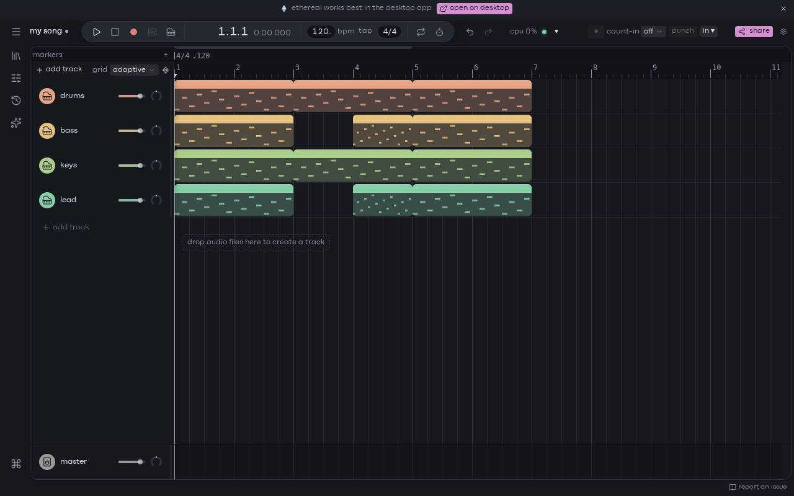

This page is a quick tour of the editor: the window you work in once a project is open. You don't need anything set up first. If you're on a phone, see [the mobile beta](/docs/mobile/mobile-beta) instead: its layout is different.

From top to bottom, the editor has a **top bar**, the **arrangement** in the middle, a thin **status bar** at the bottom, and three panels that slide in over the arrangement: the **browser** on the left, the **inspector** on the right and the **editor drawer** at the bottom.

## the top bar

From left to right:

- **The project menu.** The ☰ button opens the project menu (new, open, import, export, versions…). Next to it is the project's name: click it to rename the project. A dot after the name means some changes aren't saved yet. See [projects and saving](/docs/basics/projects).
- **The transport.** Play, stop, record, then the position, the tempo and the time signature, then loop and metronome. See [playing and moving around](/docs/basics/playing-and-navigating) and [tempo, time signature and scale](/docs/basics/tempo-and-time-signature).
- **Undo and redo**, with the name of the step each one would undo or redo when you hover it.
- **Engine indicators**: the cpu load, a disk warning and a status dot. They're described [below](#cpu-disk-and-engine-status).
- **The metronome settings, the recording controls** (record armed tracks, count-in, punch, inputs), **share** and the **settings** gear. While an audio export runs with its dialog closed, an **export %** button shows its progress.

## the arrangement

The arrangement is your song laid out in time: one row per track, time running left to right, with the ruler along the top. Clips sit on the tracks. Each track's header on the left has its name, mute, solo, arm, volume and pan.

The small toolbar in the arrangement's corner holds the grid setting and the **follow** button (see [follow the playhead](/docs/basics/playing-and-navigating#follow-the-playhead)).

To learn more, read [tracks](/docs/making-music/tracks) and [clips](/docs/making-music/clips).

## the left rail and the browser

The narrow column of icons on the far left is the **rail**. Each icon opens a panel:

- **library**: the browser, with your samples, presets and devices. See [the browser](/docs/sounds-and-plugins/browser).
- **MIDI mapping**: map hardware knobs to controls (desktop app).
- **history**: every edit you made, so you can jump back to any of them. See [undo and history](/docs/basics/undo-and-history).
- **chat**: only while you're in a live session.
- **ask AI**: the AI assistant.
- The last button opens the [command palette](/docs/basics/command-palette-and-settings).

## the inspector

The inspector opens on the right when you select something, and hides again when nothing is selected:

- With a **track** selected, it shows that track's settings and its **devices**: the instruments and effects on the track, top to bottom. See [devices and presets](/docs/making-music/devices-and-presets).
- With **clips** selected, it shows their settings (gain, transpose, warp…). With several clips selected, a change applies to all of them.

## the editor drawer

The drawer at the bottom holds the clip editors, in three tabs: **piano roll** (MIDI clips), **warp** (audio clips) and **automation**. Clicking a clip opens its editor here.

[[action:view.editor]] shows or hides the drawer at any time.

## panels that float

The browser, the inspector and the drawer float over the arrangement, so they don't take space from it while you aren't using them:

- An **unpinned** browser closes as soon as you click in the arrangement. An unpinned drawer closes when you click anywhere outside it, except on clips (clicking another clip switches the drawer to that clip).
- The **pin** button in a panel's header keeps it open, beside the arrangement instead of over it. Click it again to let the panel float.
- The **×** of the inspector and of the drawer shrinks it to a small bar along the edge. Click the bar to expand it again. It stays collapsed until you expand it (the inspector still follows the selection). Double-clicking a clip expands both: see [double-clicking a clip](/docs/making-music/clips#double-clicking-a-clip).
- Drag a panel's inner edge to resize it.

The command palette also has **pin browser**, **pin inspector** and **pin editor drawer** (and their **unpin** versions).

## the status bar

The thin bar along the bottom has **report an issue** at its right end. See [reporting issues](/docs/reference/reporting-issues).

## messages at the bottom

Short messages (toasts) appear in a corner of the window:

- **Info** messages go away by themselves after about 6 seconds. Hovering one keeps it up.
- **Warnings** and **errors** stay until you close them, so you don't miss them.
- At most 3 are shown at once; older ones are dropped. There's no list of past messages, so read a warning before you close it.

## cpu, disk and engine status

At the right of the top bar:

- **cpu** shows how busy the audio engine is (its DSP load). If it gets close to 100 %, you may hear clicks and dropouts.
- **Disk** appears only after audio streamed from disk dropped out while playing, with the number of dropouts. Click it to reset the count.
- **The status dot**, with the name of the audio system next to it, shows the engine's state. It's a warning colour while connecting or after dropouts, and an error colour when the engine failed or the audio stopped. It reads **closed** when the engine has let go of the audio device. Hover it for details: the audio system, sample rate, buffer size and the number of dropouts.

## where next

- [Playing and moving around](/docs/basics/playing-and-navigating)
- [Projects and saving](/docs/basics/projects)
- [The command palette and settings](/docs/basics/command-palette-and-settings)
