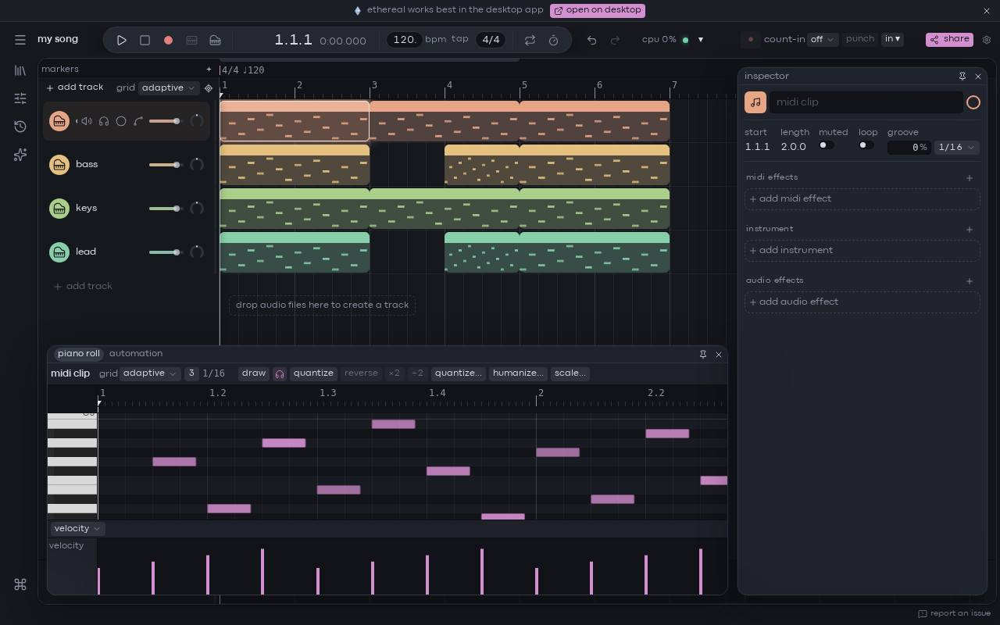

The piano roll is where you write and edit the notes of a MIDI clip. Click a MIDI clip in the arrangement and it opens in the editor at the bottom of the window. [[action:view.editor]] shows or hides that editor. Pitches run from top to bottom along the keyboard on the left, and time runs from left to right.

If you don't have a MIDI clip yet, see [clips](/docs/making-music/clips) to make one.

## drawing notes

A single click on an empty part of the grid does not draw a note: it only moves the insert marker (see [setting where playback starts](#setting-where-playback-starts)). To add a note:

- **Double-click** an empty spot. If you keep the mouse button down after the second click and drag to the right, you set the note's length as you draw.
- Or turn on **draw** in the toolbar ([[action:pianoRoll.drawMode]]). In draw mode every press adds a note, and dragging sets its length. Press it again to go back to normal editing.

New notes have a velocity of 100. On a track with an instrument, you hear each note as you draw it.

### note length and the grid

A new note is exactly one grid step long. The step is shown next to the **grid** select in the toolbar (for example `1/16`). It is not the length of the last note you drew. To draw longer notes, choose a coarser grid, or drag while drawing.

The **grid** select offers adaptive grids, which change step as you zoom, and fixed steps from **1 bar** to **1/32**, or **off**.

## deleting notes

- Double-click a note to delete it. Both clicks must land on the same note.
- Or select notes and press [[action:edit.delete]].
- Or right-click a note and choose **delete note** (or **delete N notes** for a selection).

## moving, resizing and transposing

- Drag a note's body to move it in time and in pitch.
- Drag either edge of a note to change its start or its end.
- When several notes are selected they move together, and the intervals between them are kept.

Moves and resizes snap to the grid. Every drag is one step in the [undo history](/docs/basics/undo-and-history).

### hearing notes as you edit

Pressing a note plays it on the track's instrument for as long as you hold it. A vertical drag plays it again at each new pitch. Pressing a key on the keyboard on the left plays that pitch too.

The headphones button in the toolbar turns this preview on and off. It is on by default, and your choice is remembered in this browser or app.

## selecting notes

- Click a note to select it.
- [[key:Shift]]-click adds notes to the selection.
- [[key:Mod]]-click toggles a note in or out of the selection. The toggle happens when you release the button, because a [[key:Mod]]-drag duplicates instead (see below).
- Drag on an empty part of the grid to draw a selection rectangle.
- [[action:edit.selectAll]] selects every shown note. [[action:edit.deselect]] clears the selection.

### selecting every note of one pitch

Click a key on the keyboard on the left: it plays the pitch and selects every note on that row. [[key:Shift]] and [[key:Mod]] add to the selection as they do on notes. This is a quick way to edit all the hits of one drum sound.

## velocity

Velocity is how hard a note is played. Higher velocities are usually louder or brighter, depending on the instrument.

The fastest way to change it is to hold [[key:Alt]] over a note: the cursor becomes an up/down arrow. Then drag vertically. If the note is part of a selection, every selected note changes by the same amount. A badge shows the value while you drag. Add [[key:Shift]] for finer steps.

> [!note]
> In Ableton Live, [[key:Alt]]-drag duplicates notes. Here [[key:Alt]]-drag edits velocity, and [[key:Mod]]-drag duplicates.

### the velocity lane

Under the grid, the velocity lane shows one bar per note. Drag a bar up or down to change that note's velocity. If the bar belongs to a selected note, the whole selection changes by the same amount. Hover a bar to see its value.

## duplicating notes

Hold [[key:Mod]] while you drag a note: the originals stay where they are and you drag copies. You can press [[key:Mod]] at the start or in the middle of the drag. If you release [[key:Mod]] before you drop, the copies go away and you are moving the originals again. The cursor shows a copy sign while you are copying.

[[action:edit.duplicate]] duplicates the selected notes right after themselves.

## turning snapping off

Which key turns snapping off depends on what you are dragging:

- **Moving notes:** hold [[key:Shift]]. [[key:Alt]] also works if you press it during the move. If you hold [[key:Alt]] *before* you press a note, you edit its velocity instead.
- **Everything else** (drawing, resizing, selection rectangles, clicking to place the marker, the stretch bar, expression points): hold [[key:Alt]].

## nudging with the arrow keys

With notes selected:

- [[action:nudge.up]] and [[action:nudge.down]] move them one semitone.
- [[action:pianoRoll.octaveUp]] and [[action:pianoRoll.octaveDown]] move them one octave.
- [[action:nudge.left]] and [[action:nudge.right]] move them one grid step earlier or later. The distance follows the grid, so zooming with an adaptive grid changes it.

You can change these keys in [keyboard shortcuts](/docs/reference/keyboard-shortcuts).

## setting where playback starts

A click on an empty part of the grid places the insert marker there, snapped to the grid ([[key:Alt]]: not snapped). While the song is stopped, play starts from that point. It never moves the playhead while the song is playing. Clicking the ruler above the grid moves the play position directly.

## sections

A section is a time range that covers the rows you dragged over. It changes what copy, paste and delete do (see the next part).

- A plain drag on empty space selects notes.
- A [[key:Shift]]-drag on empty space makes a section *and* selects the notes under it. You can press or release [[key:Shift]] during the drag to switch.
- Dragging on the thin strip under the ruler also makes a section, across all rows.
- [[action:edit.selectAll]] selects every shown note and makes a section of the whole clip.

Pressing a note, or [[action:edit.deselect]], leaves the section.

### editing with a section

When a section exists:

- [[action:edit.copy]], [[action:edit.cut]], [[action:edit.paste]] and [[action:edit.duplicate]] work on the section's exact time span, including empty space. Notes that cross the section's edges are cut at the edges. Duplicate places the copy right after the section, so it can leave silence after the last note.
- [[action:edit.split]] splits the notes that cross the section's edges, at both edges. With only the insert marker, it splits the notes that cross the marker (the selected ones, if any).
- [[action:edit.delete]] clears what is inside the section.

Without a section, these keys act on the selected notes.

## quantize

Quantize moves notes onto the grid. The **quantize** button and [[action:pianoRoll.quantize]] apply the settings from the **quantize…** popover:

- **grid**: **roll grid** (the piano roll's current step, the default) or a fixed value from 1/4 to 1/32, triplets included.
- **strength**: how far notes move toward the grid (100% snaps them exactly).
- **swing**: delays every other grid step.
- **quantize ends**: also moves note ends.

It acts on the selected notes, or on every note in the clip when nothing is selected. The quantize and humanize settings are remembered on this computer, for every project.

> [!tip]
> The one-click **quantize** button reuses whatever strength and swing you set last in the popover. Open **quantize…** to check them first.

The **humanize…** popover next to it does the opposite: it adds small random changes to timing and velocity. See [groove, swing and humanize](/docs/advanced/groove).

## scales

The scale button in the toolbar shows the active scale (for example **c minor…**). Its popover sets:

- **track**: **follow project scale** (the default), **custom track scale**, or **chromatic / none**.
- the root and type of the scale.
- **highlight**: marks the notes of the scale and its root, and dims the others.
- **scale notes only**: shows only the rows of the scale.

A scale is a visual guide only. Nothing is forced into the scale: MIDI input, recording, the [computer MIDI keyboard](/docs/making-music/computer-midi-keyboard) and the arrow keys can still produce any pitch.

### scale notes only

With **scale notes only** on, the rows outside the scale are folded away. Notes on those rows are not deleted: they are kept and still play, but you can't see them. [[action:edit.selectAll]] only selects the shown notes. Turn the toggle off to see every pitch again or to draw outside the scale.

### project scale or track scale

When the track follows the project scale, changing the root or the type in this popover changes the *project* scale. Every track that follows it changes too. The label next to the selects says **project** or **track** to show which one you are editing. To change only this track, switch **track** to **custom track scale** first.

## stretching and reversing notes

When notes are selected, a bar on the ruler spans them:

- Drag either end of the bar to stretch or squeeze the notes in time ([[key:Alt]]: no snapping).
- Drag the middle of the bar to move them.
- **×2** and **÷2** in the toolbar double or halve their length, measured from their start.

**reverse** in the toolbar, or [[action:clip.reverse]], mirrors the selected notes in time (or the notes in the section, when there is one).

## key height and triplets

- Drag the grip above the keyboard up or down to make the keys taller or shorter. Double-click it to go back to the default height.
- The **3** button switches the grid to triplets.

## looping clips

When a clip loops, the repeats after the first pass show the loop's notes as faded ghosts. Only the first pass is real. If you draw in a repeat, the note is written into the loop itself, so it appears in every pass.

## editing several clips at once

Select several MIDI clips in the arrangement, then open one of them, or right-click and choose **edit N clips in piano roll**. The piano roll then shows all of them on the song's timeline:

- A strip under the ruler shows each clip's band, with its name and loop.
- Notes take their clip's color. The notes of clips other than the focused one are dimmed.
- Click a clip's band, or one of its notes, to focus that clip. The toolbar title, the scale and the expression lanes follow the focused clip.
- Selecting, moving, nudging, quantize, velocity, copy and paste all work across the clips. One drag is one undo step, even when it changes several clips.

### limits when editing several clips

- A note can't leave its clip. A move stops at the edge of the clip's region.
- Nothing is drawn outside a clip. A new note goes into the clip under the pointer.
- Paste puts each note into the clip under it and drops notes that land outside every clip.
- Clips never grow while several are open.

## drum rack tracks open the beat editor

On a track with a [drum rack](/docs/making-music/drum-rack), clips open in the beat editor instead: a step grid with one row per pad and one cell per 16th note.

- Click a cell to add or remove a hit. Right-click a cell to remove one.
- Drag along a row to paint several hits, or to erase them if you started on a hit or used the right button.
- A cell's brightness shows its velocity.

The **beat editor** and **piano roll** tabs at the right of the toolbar switch between the two editors for that track.

## where next

- [The computer MIDI keyboard](/docs/making-music/computer-midi-keyboard): play notes without any hardware.
- [Expression and MPE](/docs/making-music/expression-and-mpe): pitch bend, mod wheel and per-note curves.
- [Recording](/docs/making-music/recording) and [capture MIDI](/docs/making-music/capture-midi): record what you play.
- [Devices and presets](/docs/making-music/devices-and-presets): choose the sound your notes play.
