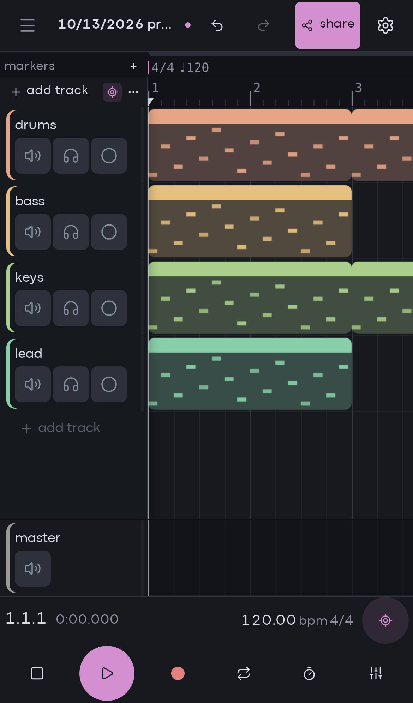

Ethereal is made for a computer with a mouse and a keyboard. A touch version for phones and tablets is in development: you can try it now as a beta in your phone's browser. This page explains how to turn it on, what you see, and what still needs a computer. The gestures themselves are on [touch gestures](/docs/mobile/gestures).

## phones and tablets

When you open Ethereal in a phone's browser, it doesn't start the editor. Instead it shows **ethereal is not available on mobile — try it on desktop**, with three things you can do:

- **copy link**: copy the address, to open it later on a computer.
- **open this link on a computer**: a reminder that the full editor runs there.
- **try the mobile beta**: start the touch version (see below).

Ethereal looks at the device, not the window size, to decide:

- Phones are blocked in both orientations, even when the browser asks for the desktop site.
- Tablets without a mouse or trackpad are blocked too, because there's nothing to drag with precisely.
- A tablet with a keyboard and trackpad (an iPad with a Magic Keyboard, for example) gets the normal desktop editor.
- Laptops with a touchscreen get the desktop editor.

Two kinds of links always work on a phone, with or without the beta: [static share links](/docs/sharing/static-links) (`/s/…`), which open the read-only [share viewer](/docs/sharing/share-viewer), and this documentation.

## turning on the mobile beta

Tap **try the mobile beta** on the "not available" screen, or add `?mobile=1` to the address yourself. The touch version then starts, with the real audio engine running in your browser.

- The choice is remembered for that browser tab, so reloading keeps the beta on.
- `?mobile=0` in the address turns it off again for the tab.
- `?force-desktop` starts the desktop editor anyway. It's hard to use without a mouse, but it's there if you need a feature the beta doesn't have.

> [!warning]
> On the web, your projects live only in this browser's storage. Clearing your browser data deletes them. Export a project (project menu → **export project…**) to keep a copy. See [where your projects live](/docs/welcome/where-your-projects-live).

## the layout

The beta uses the same arrangement as the desktop, laid out for a thumb:

- **The top bar**: the project menu (tap the project name; it has **export audio…** too), **undo** and **redo**, **share** and the settings button.
- **The arrangement**: tracks and their clips. On a phone, each track header shows the name and then **mute**, **solo** and **arm** at touch size. Volume, pan, takes and automation are in the [track sheet](/docs/mobile/gestures#the-track-sheet).
- **The status row**: the position, the tempo and time signature, and the **follow playhead** button.
- **The transport** at the bottom: **stop**, **play** / **pause**, **record**, **loop**, **metronome**, and a button that switches between the tracks and the [mixer](/docs/mobile/editing-on-touch#the-mixer).

When you turn a phone sideways, the top bar and the transport move to one row at the bottom, so the arrangement gets the whole height. On a tablet, the status and the transport sit in one row at the bottom in both orientations, and the track headers keep their volume and pan.

There is no side rail, no browser and no floating device windows. Panels open as sheets that slide up from the bottom.

## what still needs a computer

The beta is for arranging and editing what's already in a project. These things aren't on mobile yet:

- **Adding sounds**: there's no sample browser and no way to drop files, so you can't bring in audio. New clips are MIDI clips: double-tap a MIDI track's lane to make one.
- **Devices**: the track sheet lists a track's devices, but you can't change them or open their windows ("edit devices on a computer for now"). No plugins either.
- **Recording**: the browser has no audio or MIDI inputs for Ethereal, so recording needs the desktop app. The **record** button is greyed out. See [recording](/docs/making-music/recording).
- **Keyboard features**: no command palette, keyboard shortcuts or computer MIDI keyboard.
- **MIDI mapping**, guided tours and the AI assistant.

To report a problem from your phone, use **report an issue…** in the project menu (there is no status bar on mobile).

## projects, sharing and settings

The project screen, the project menu, sharing and settings all work on a phone:

- Dialogs such as settings open full screen, and their buttons are touch-sized.
- On the project screen, each project's **rename**, **duplicate** and **delete** buttons are always shown (there's no hover on a touchscreen).
- The project's address is kept in the address bar, so reloading the page reopens the same project.
- **share** works as on a computer. See [sharing your music](/docs/sharing/overview).
- An invite link to a live session first shows the "not available" screen on a phone. Tap **try the mobile beta** there (or open the link in a tab where the beta is already on): the join screen appears, and **continue in browser** joins the session in the touch version. See [joining a session](/docs/sharing/joining).

## leaving the app stops playback

When you leave the browser (switching apps, locking the screen, taking a call), playback stops. If something was recording, that take is finished. Coming back doesn't start playing again: tap **play** when you're ready.

## rotating the phone

Turning the phone keeps your place: the beat in the middle of the screen stays in the middle, and the zoom and selection are kept. The layout switches between portrait and landscape as described in [the layout](#the-layout).

## where next

- [Touch gestures](/docs/mobile/gestures): pan, zoom, select and move clips.
- [Editing on touch](/docs/mobile/editing-on-touch): the piano roll, automation and the mixer.
- [Where your projects live](/docs/welcome/where-your-projects-live).
